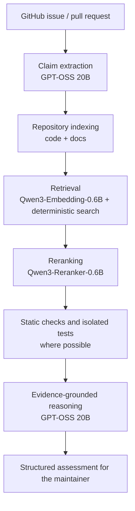

# Fourensics — Hacktoberfest 2026 Hack Day Sonipat

> **Status:** This document describes the models we have **selected** and the **intended** architecture for Fourensics. It is a design statement, not a report of completed work. Nothing below should be read as a claim that a model is already integrated, deployed, or benchmarked.

## Project Summary

| Field | Details |
| --- | --- |
| **Project name** | Fourensics |
| **Event** | Hacktoberfest 2026 Hack Day Sonipat |
| **Selected problem** | Problem 02 – Evidence-Based Open Source Issue and Pull Request Triage |
| **Team name** | Buy2Get1 |
| **Team size** | 4 members |
| **Tech stack** | React (frontend) + FastAPI (backend) |
| **Primary reasoning model** | Organizer-hosted model server (GPT-OSS 20B) |
| **Retrieval models** | Local inference (Qwen3-Embedding-0.6B, Qwen3-Reranker-0.6B) |
| **Project license** | MIT |
| **Repository URL** | _TODO: add repository URL_ |
| **Demo / video link** | _TODO: add link, if required by the submission rules_ |

Fourensics helps maintainers triage GitHub issues and pull requests by breaking them into individual technical claims and checking each claim against the repository's actual source code, documentation, and verification results, rather than relying on a language model's opinion alone.

## Team

**Team name:** Buy2Get1

| # | Member | GitHub handle | Role / focus |
| --- | --- | --- | --- |
| 1 | Ishan Maheshwari | _TODO_ | _TODO_ |
| 2 | Ganga Raghuwanshi | _TODO_ | _TODO_ |
| 3 | Anuradha Raghuwanshi | _TODO_ | _TODO_ |
| 4 | Bhawana | _TODO_ | _TODO_ |

_TODO: Fill in GitHub handles and roles. Add any other information the Hacktoberfest 2026 submission form requires (for example, a contact person or institution)._

## Selected AI Models

Fourensics is designed around three specialized models, each with a single, well-defined responsibility.

| Role | Model | Deployment |
| --- | --- | --- |
| Technical reasoning | GPT-OSS 20B | Organizer-hosted inference server |
| Semantic retrieval | Qwen3-Embedding-0.6B | Local inference |
| Evidence ranking | Qwen3-Reranker-0.6B | Local inference |

### 1. GPT-OSS 20B

| Field | Details |
| --- | --- |
| **Model ID** | `openai/gpt-oss-20b` |
| **Provider** | OpenAI |
| **License** | Apache 2.0 |
| **Deployment** | Organizer-hosted inference server |

**Intended purpose**

- Extract individual, verifiable technical claims from GitHub issues and pull requests.
- Reason over repository source code and documentation.
- Assess whether claims are supported, contradicted, or inconclusive.
- Generate structured, evidence-backed assessments.
- Produce confidence and uncertainty explanations.

**Why we selected it**

GPT-OSS 20B offers a strong balance between reasoning capability and deployment efficiency. Its mixture-of-experts architecture has approximately 21B total parameters, with 3.6B active parameters. Its structured-output and tool-calling capabilities make it suitable for our evidence-driven assessment pipeline.

### 2. Qwen3-Embedding-0.6B

| Field | Details |
| --- | --- |
| **Model ID** | `Qwen/Qwen3-Embedding-0.6B` |
| **Provider** | Alibaba Qwen |
| **License** | Apache 2.0 |
| **Deployment** | Local inference |

**Intended purpose**

- Convert source code, documentation, and technical claims into semantic embeddings.
- Retrieve relevant code snippets and documentation.
- Find semantically relevant implementations even when exact keywords differ.

**Why we selected it**

Its relatively small size, 32K context length, and semantic retrieval capabilities make it suitable for indexing and searching code repositories without requiring an unnecessarily large embedding model.

### 3. Qwen3-Reranker-0.6B

| Field | Details |
| --- | --- |
| **Model ID** | `Qwen/Qwen3-Reranker-0.6B` |
| **Provider** | Alibaba Qwen |
| **License** | Apache 2.0 |
| **Deployment** | Local inference |

**Intended purpose**

- Re-evaluate retrieved code and documentation against individual technical claims.
- Rank candidate evidence by relevance.
- Reduce irrelevant context before sending evidence to GPT-OSS.

**Why we selected it**

Reranking improves evidence quality by distinguishing genuinely relevant implementation details from superficially similar search results. The 0.6B model provides a practical quality-to-compute trade-off.

## Model Selection Philosophy

### Why three specialized models instead of one large model

We deliberately split the problem into three distinct stages and assign each to a model suited to that stage:

1. **Technical reasoning — GPT-OSS 20B.** Interprets claims and evidence and writes the structured assessment.
2. **Semantic retrieval — Qwen3-Embedding-0.6B.** Finds candidate code and documentation, including when wording differs from the claim.
3. **Evidence ranking — Qwen3-Reranker-0.6B.** Scores candidates against each individual claim and filters out noise.

Keeping these responsibilities separate lets each component be evaluated, replaced, and reasoned about independently. Small local models handle high-volume retrieval and ranking, so the larger hosted model only needs to see a compact, pre-filtered set of evidence.

### Principles

- **The LLM is not the source of truth.** We do not treat model output as fact.
- **Verification comes from real artifacts.** Actual source-code inspection, static analysis, test execution, and controlled reproduction provide the verification evidence.
- **The reasoning model interprets evidence; it does not invent results.** GPT-OSS receives retrieved evidence and real verification outputs and is asked to reason over them, not to guess at outcomes it was never shown.
- **Uncertainty is part of the output.** When evidence is insufficient, Fourensics must say so instead of forcing a verdict.
- **We prioritize evidence quality, reliability, inference efficiency, and explainability** over simply using the largest available model.

## System Overview

The intended workflow is:

1. **Receive input.** Accept a GitHub issue or pull request.
2. **Extract claims.** Use GPT-OSS to extract atomic technical claims.
3. **Index the repository.** Index repository source code and documentation.
4. **Retrieve candidates.** Find relevant files using semantic embeddings alongside deterministic search.
5. **Rerank evidence.** Rerank candidate evidence using Qwen3-Reranker.
6. **Verify.** Run appropriate static checks and safely isolated tests where possible.
7. **Reason over evidence.** Send the retrieved evidence and the actual verification results to GPT-OSS.
8. **Report.** Generate a structured assessment for the maintainer.

### Assessment categories

Each claim is assessed individually and may receive one of the following categories:

| Category | Meaning |
| --- | --- |
| **Supported** | The gathered evidence is consistent with the claim. |
| **Contradicted** | The gathered evidence conflicts with the claim. |
| **Inconclusive** | The evidence is insufficient or ambiguous to decide either way. |
| **Not reproduced** | An attempted reproduction did not produce the behavior described. |

> **Important:** These categories are **per-claim assessments**. They are decision support for maintainers and must not automatically be interpreted as a final judgment about a contributor.

## Hacktoberfest 2026 Submission Checklist

_TODO: Verify each item against the official Hacktoberfest 2026 Hack Day Sonipat submission requirements and update this list._

- [ ] Team details completed (GitHub handles and roles)
- [ ] Repository URL added
- [x] MIT `LICENSE` file present in the repository root
- [ ] Selected problem and models documented (this file)
- [ ] Implementation completed and this document updated to reflect actual integration status
- [ ] Demo / video link added (if required)
- [ ] Any additional organizer-specified requirements satisfied

## Implementation Status

| Component | Status |
| --- | --- |
| React frontend | _TODO_ |
| FastAPI backend | _TODO_ |
| GPT-OSS 20B integration (organizer-hosted) | _TODO_ |
| Qwen3-Embedding-0.6B (local) | _TODO_ |
| Qwen3-Reranker-0.6B (local) | _TODO_ |
| Static analysis and isolated test execution | _TODO_ |

_TODO: Update this table as components are built. Hardware specifications, latency figures, and evaluation results will be added here only once they have been measured._

## Licenses

**Fourensics** is released under the **MIT License**.

The three selected models are separate third-party works and are not covered by the project license. All three are listed by their providers under the Apache 2.0 license. Please confirm the license terms on each model's official page before redistribution.
