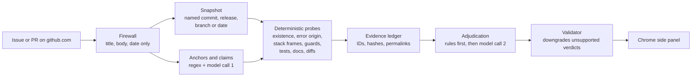

# FOURENSICS

**Evidence-based triage for GitHub issues and pull requests.**

FOURENSICS breaks a bug report or pull request into individual technical claims and checks each one against the repository's code, at the version the reporter was using. The results appear in Chrome's side panel next to the GitHub page, and every finding links to the exact lines it is based on.

Most AI triage tools summarise the report text. FOURENSICS checks it against the code. When the evidence doesn't settle a claim, it says so instead of guessing.

[](https://github.com/IshanMaheshwari-777/FOURENSICS/actions/workflows/ci.yml)
[](https://github.com/IshanMaheshwari-777/FOURENSICS/actions/workflows/pages.yml)
[](LICENSE)

- **Download the extension:** https://ishanmaheshwari-777.github.io/FOURENSICS/
- **Hackathon write-up:** [HACKATHON.md](HACKATHON.md)
- **Team blog post:** [see below](#blog)

Built by team **Buy2Get1** for **Hacktoberfest 2026 Hack Day Sonipat**, Problem 02: *Evidence-Based Open Source Issue and Pull Request Triage*.

---

## Contents

- [What it does](#what-it-does)
- [How it works](#how-it-works)
- [Quick start](#quick-start)
- [Using it](#using-it)
- [Configuration](#configuration)
- [API](#api)
- [Evaluation](#evaluation)
- [Development](#development)
- [Project layout](#project-layout)
- [Security and privacy](#security-and-privacy)
- [Limitations](#limitations)
- [Team](#team)
- [Blog](#blog)
- [AI disclosure](#ai-disclosure)
- [License](#license)

---

## What it does

| | |
| --- | --- |
| **Claim by claim** | Splits a report into individual claims, each tied to the reporter's exact words, and checks every claim separately. |
| **The right version of the code** | Uses the commit, release or branch the reporter names; otherwise uses the code as it was when the report was written, so later fixes can't leak into the answer. For pull requests it uses the exact base and head commits. |
| **Evidence you can click** | Every finding links to the exact lines at that commit, with a hash of the lines it quotes. |
| **Two separate results per claim** | A technical result (*supported*, *contradicted* or *inconclusive*) and an execution result (*reproduced*, *not reproduced*, *not attempted* or *environment unavailable*). |
| **Suggested label** | Proposes `confirmed`, `invalid` or `cannot reproduce`, but only when code or a reproduction backs it. Otherwise it shows none. |
| **Pull requests** | Compares the description with the diff, the changed tests and CI status. PR code is never run. |
| **What's missing** | Lists the details a report lacks (version, steps, error output, environment) and drafts a polite reply into the comment box. It never posts anything. |
| **Chrome side panel** | Opens beside the page from the toolbar icon or a slim tab on the page edge, follows the active tab, and supports light and dark themes. |
| **Any language** | Python gets the deepest structural checks. Other languages get text-based definitions, exact matches, docs and diff checks. |

## How it works

FOURENSICS is a fixed pipeline, not a free-running agent. The model does exactly two jobs:

- **pull out claims** from the report
- **interpret evidence** the pipeline has already collected

It never chooses commands or runs code. Everything else is deterministic and testable.



1. **Firewall.** Only the title, the original body, the creation date and (when used live) the reporter's own follow-ups reach the model. Labels, maintainer comments, linked fixes and merge state never do.
2. **Snapshot.** The pipeline picks the version the reporter used: a named commit first, then a release tag, then a monorepo tag, then a named branch, and finally the default branch as it was when the report was written. The repository is partially cloned, and the snapshot is checked out as a worktree.
3. **Anchors and claims.** Regular expressions pull out file paths, symbols, errors, stack-trace frames, versions and code blocks. The model then splits the report into claims, and any claim that doesn't quote the report word for word is dropped.
4. **Probes.** These check:
   - whether the named code exists
   - where an error message comes from
   - whether stack frames match
   - guards, tests and docs
   - what changed between versions
   - for PRs: diff alignment, changed tests and CI status

   Python is analysed with its AST; other languages get bounded text search.
5. **Evidence ledger.** Every observation gets an ID, a tier (E1 execution, E2 measured source fact, E3 source context, E4 search context), a sha256 of the exact lines and a GitHub permalink.
6. **Adjudication and validation.** Narrow rules run first. The model then interprets only the cited evidence, and a rule-based validator downgrades any verdict that evidence doesn't support. Not finding something is never treated as proof a claim is false, and a text match alone never proves behaviour.

**Models**
- **Default:** Gemma 4 26B (`gemma-4-26b-a4b-it`), hosted open-weight, through Google's API.
- **Alternatives:** any OpenAI-compatible server, for example GPT-OSS 20B, OpenRouter or a local Ollama.
- **Speed:** a typical analysis takes about 35–60 seconds on Gemma's free tier. Most of that is waiting on the provider's per-minute token limit.

## Quick start

**You need:**
- Chrome 116+ or another Chromium browser with side panels
- Python 3.11+ and Git
- macOS or Linux (on Windows, use WSL)
- Node 20+, only if you build the extension yourself

### 1. Install the extension

**Option A: download** (easiest)

1. Download `fourensics-extension.zip` from https://ishanmaheshwari-777.github.io/FOURENSICS/ and unzip it.
2. Open `chrome://extensions`, turn on **Developer mode**, click **Load unpacked** and select the unzipped folder.
3. Pin **FOURENSICS** from the puzzle-piece menu so its icon stays in the toolbar.

**Option B: build from source**

```bash
cd extension && npm ci && npm run build
```

Then load `extension/dist` unpacked, as in Option A.

### 2. Try it without a backend (optional)

Open the side panel's **Settings** (the gear icon), tick **Mock mode**, and open any GitHub issue. The panel shows a bundled example result.

### 3. Run the analysis backend

```bash
git clone https://github.com/IshanMaheshwari-777/FOURENSICS.git
cd FOURENSICS
python3 -m venv backend/.venv
backend/.venv/bin/pip install -e backend
cp backend/.env.example backend/.env
```

Edit `backend/.env`:
- **`GOOGLE_API_KEY`:** a free key from Google AI Studio.
- **`GITHUB_TOKEN`:** recommended. A read-only token raises GitHub's limit from 60 to 5,000 requests an hour.

Then start the backend:

```bash
scripts/dev.sh backend
```

The API listens on `http://localhost:8787`, which is the extension's default. Check it with:

```bash
curl -s http://localhost:8787/api/health
```

### 4. Use it

Open any public GitHub issue or pull request and click the FOURENSICS toolbar icon, or the **FOURENSICS** tab on the page's right edge. Untick Mock mode if you set it.

## Using it

The side panel reads top to bottom:

1. **Verdict.** The main finding in one line, such as "Backed by the code." or "The code disagrees with the main claim.", with a matching status colour.
2. **Facts.**
   - the code version checked and how reliable that match is
   - whether anything was executed
   - the suggested label, shown only when evidence backs it
3. **Claims.** One card per claim, with the main claim first. Filter by *Supported*, *Contradicted* or *Unresolved*. Each claim shows:
   - its explanation
   - its execution status
   - cited evidence, with links to the exact lines and expandable source excerpts
   - limitations
   - a Yes/No feedback button
4. **Information that would help.** What the report is missing, plus **Insert suggested reply**, which fills GitHub's comment box for you to review. It never submits.
5. **Analysis details.** Scope, every pipeline stage and its status, notes, the model, pipeline version, run ID and the commit checked.

Results are cached per issue, body and pipeline version, so reopening an issue is instant. Use ↻ to run the analysis again.

## Configuration

All backend settings live in `backend/.env`, which is git-ignored; see [`backend/.env.example`](backend/.env.example). The main ones:

| Variable | Default | Purpose |
| --- | --- | --- |
| `GOOGLE_API_KEY` | – | Google AI Studio key; selects hosted Gemma automatically |
| `GOOGLE_MODEL` | `gemma-4-26b-a4b-it` | Any hosted Gemma model ID |
| `LLM_PROVIDER` | `auto` | `auto`, `google` or `openai` (OpenAI-compatible) |
| `LLM_BASE_URL` / `LLM_API_KEY` / `LLM_MODEL` | – / – / `openai/gpt-oss-20b` | OpenAI-compatible server (GPT-OSS, OpenRouter, Ollama, …) |
| `GOOGLE_TOKENS_PER_MINUTE` | `14000` | Pacing so requests stay under the provider's per-minute cap |
| `LLM_CACHE_ONLY` | `false` | Serve validated cached model replies only; no live calls |
| `GITHUB_TOKEN` | – | Read-only token for higher GitHub API limits |
| `GITHUB_APP_ID` / `GITHUB_APP_PRIVATE_KEY_PATH` / `GITHUB_WEBHOOK_SECRET` | – | Optional read-only GitHub App with signed webhooks |
| `ENABLE_SANDBOX` | `false` | Optional Docker reproduction of allow-listed Python snippets |
| `RUN_TIMEOUT_S` / `GIT_TIMEOUT_S` | `300` / `120` | Time limits per run and per git command |

The extension's **Settings** page sets the backend URL and Mock mode. A backend that isn't on localhost asks for host permission when you save it.

## API

| Endpoint | What it does |
| --- | --- |
| `GET /api/assessment?url=<issue or PR URL>` | Returns the cached result, or starts a run and returns `status: queued` with a `run_id`. Add `&refresh=true` to re-run. |
| `GET /api/runs/{run_id}` | The current result. Partial results fill in as stages finish. |
| `POST /api/feedback` | `{run_id, claim_id, vote: "yes" \| "no"}` |
| `POST /api/webhooks/github` | GitHub App webhook. Verifies the HMAC signature, then queues a run for opened or edited issues and PRs. |
| `GET /api/health` | Database, model provider, quota cooldown, GitHub and sandbox status. |

Results follow the `PanelResult` schema in [`backend/app/schemas.py`](backend/app/schemas.py). It is mirrored in [`extension/src/types.ts`](extension/src/types.ts), and a test keeps the two in sync.

## Evaluation

The evaluation harness in [`eval/`](eval/):

1. **Collect.** `collect.py` gathers closed issues labelled `confirmed`, `invalid` or `cannot reproduce`. It skips bodies edited after creation and keeps the labels in a separate file the pipeline never reads.
2. **Run.** `run_eval.py` runs the pipeline in evaluation mode, where the code snapshot can never be newer than the report.
3. **Score.** Results are scored two ways:
   - **strict:** abstaining is allowed
   - **forced choice:** a label is always picked

Measured results (small samples, so indicative rather than a benchmark):

| Test | Result |
| --- | --- |
| 18 fresh issues and PRs from 14 repos in 8 languages | 18/18 completed, with no crashes or failed stages. Median 60 s back-to-back, about 35 s alone. |
| PR verdicts in that set | 7/7 correct ("the diff backs the main claim", checked by hand) |
| 20 held-out labelled issues from 7 repos, never used for tuning | Forced choice 5/20; strict mode answered 3 and matched 1 |

Predicting a maintainer's label from static evidence is hard: whether someone *could reproduce* a hardware-specific or intermittent bug isn't visible in the code. That's why the panel shows a label only when code or a reproduction backs it, and puts the per-claim evidence first. Details are in [HACKATHON.md](HACKATHON.md).

## Development

```bash
scripts/dev.sh setup     # backend venv + extension dependencies
scripts/dev.sh check     # run every guard before and after a change
scripts/dev.sh backend   # API on http://localhost:8787 (auto-reload)
scripts/dev.sh ext       # build the extension into extension/dist
scripts/dev.sh site      # build the download page and zip into build/site
```

To preview the panel with example data outside GitHub:

```bash
cd extension && npm run preview:panel
```

Then open `http://localhost:5174/dev/preview.html`. Add `?width=360` to try other panel widths.

**`scripts/dev.sh check`** runs, in order:
1. **Secret scan:** no keys in committable files; `.env` and local data stay ignored.
2. **Backend tests (225):**
   - unit tests
   - a golden snapshot of five pipeline scenarios
   - invariants
   - performance budgets: model calls, GitHub calls, prompt size, indexing time
   - saved-output compatibility
3. **Extension typecheck and 16 panel tests.** The panel tests render every state and check escaping, link safety and outcome counts.
4. **Build and 10 bundle checks:**
   - size budgets; the GitHub content script is 4 KB
   - permissions limited to `sidePanel` and `storage`
   - host access limited to the local backend
   - no `eval`
5. **Download-site check:** one self-contained page whose version matches its zip.

**CI** ([`ci.yml`](.github/workflows/ci.yml)) runs the same checks on every pull request and every push to `main`, with read-only permissions and no keys. The **Site** workflow ([`pages.yml`](.github/workflows/pages.yml)) republishes the download page and extension zip to GitHub Pages on every merge to `main`.

All tests run offline. They use local fixture repositories and a fake model, so they need no keys, network or model quota.

## Project layout

```
backend/
  app/
    main.py              API, cache, job queue, webhooks, feedback
    config.py            settings and PIPELINE_VERSION
    schemas.py           shared result types (PanelResult and friends)
    github/              read-only REST client, App auth, URL parsing, webhooks
    llm/                 gateway: structured output, cache, pacing, retries; Google Gemma adapter
    pipeline/
      firewall.py        which report fields the model may see
      snapshot.py        historical versions and worktrees
      extract_regex.py   anchors: paths, symbols, errors, frames, versions
      claims.py          model claim extraction and source-span checks
      index.py probes.py retrieval.py   source structure and deterministic checks
      ledger.py          evidence IDs, hashes, permalinks
      adjudicate.py validator.py        verdicts and safeguards
      triage.py          suggested label and report signals
      pr.py sandbox.py   pull-request checks; optional Docker reproduction
  tests/                 225 tests, golden snapshots, fixture repos
extension/
  src/sidepanel.tsx      side panel: follows the active tab, polls the backend
  src/content.tsx        4 KB GitHub script: reports the page, inserts reply drafts, edge launcher
  src/background.ts      service worker: backend calls, tab ↔ panel messaging
  src/panel/             panel UI (React) and styles
  public/                manifest, side panel page, settings page, icons
eval/                    dataset collection, evaluation runs, metrics, saved examples
site/index.html          the one-page download site (published by pages.yml)
scripts/                 dev helper, secret scan, site builder, preflight
```

## Security and privacy

- **Read-only.** FOURENSICS never comments, labels, closes or writes to a repository. Reply drafts are inserted into the comment box for you to review and send yourself.
- **Public data only.** Repository visibility is checked before any issue or PR content is fetched.
- **No repository code is executed** during static analysis, and pull-request code is never run. The optional sandbox is off by default and limited to an allow-list of Python snippets. When it runs, it uses no network, a read-only filesystem, an unprivileged user, dropped capabilities and resource limits.
- **Least-privilege extension.**
  - **Permissions:** `sidePanel` and `storage` only.
  - **Network:** host access only to the local backend.
  - **GitHub pages:** the content script runs only on github.com.
- **Keys stay local.** Keys live in the git-ignored `backend/.env` and are sent only in request headers, never in URLs or prompts. CI runs a secret scan on every change.
- **Local service.** It's built to run on your machine. Exposing it publicly would need authentication and rate limiting first.

## Limitations

- Static checks can't settle everything. Races, leaks, performance, hardware- and OS-specific behaviour, and external services often stay *inconclusive*.
- Python gets the deepest analysis; other languages get shallower, text-based checks.
- The model can misread evidence. The validator catches many unsupported verdicts but can't guarantee interpretation.
- A commit hash mentioned in passing can occasionally be mistaken for the reporter's version.
- Free-tier model limits (tokens per minute and per day) slow runs down when many are made back-to-back.
- Results support a maintainer's judgement. They don't replace it.

## Team

**Buy2Get1**, Hacktoberfest 2026 Hack Day Sonipat:

- Ishan Maheshwari
- Ganga Raghuwanshi
- Anuradha Raghuwanshi
- Bhawana

## Blog

As an optional part of the event, the team wrote a blog post about AI for the **MLH x DEV Writing Challenge**. It is separate from FOURENSICS.

<!-- Replace this line with the published dev.to post URL, e.g. https://dev.to/<username>/<post-slug> -->
- **Read it:** link coming soon (the post is being published on dev.to).

## AI disclosure

FOURENSICS was built with AI coding agents, as the hackathon requires us to disclose:

- **Claude Code** with **Claude Opus 5.5** (`claude-opus-5-5`)
- **OpenAI Codex**

Every commit and pull request names the agent and model used. At runtime the tool itself uses Gemma 4 26B (`gemma-4-26b-a4b-it`) by default, or optionally GPT-OSS 20B through an OpenAI-compatible server.

## License

[MIT](LICENSE). Third-party models and analysed repositories keep their own licenses.
